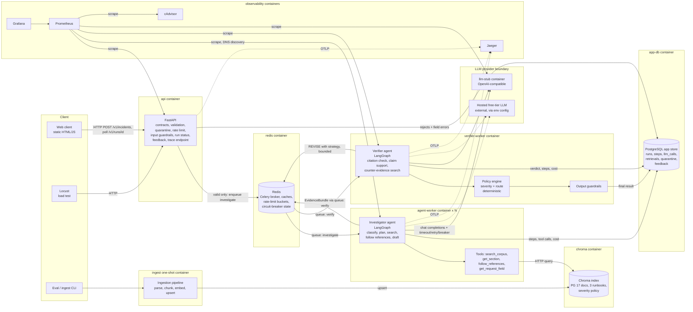
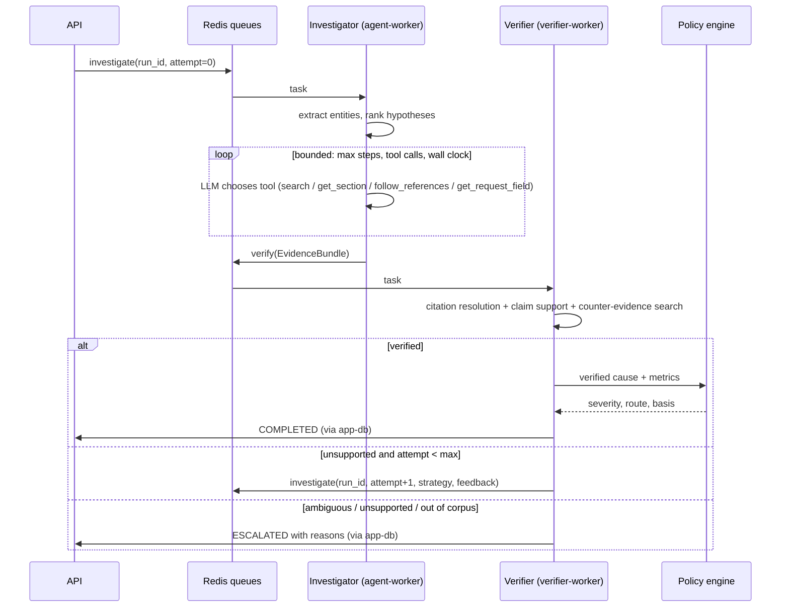

# Architecture — Production Incident Triage and Runbook Assistant

Specification: `MiniProject_08_Incident_Triage_Runbook.pdf`. Requirement IDs (F*, A*, L*, D*) refer to [requirements-matrix.md](requirements-matrix.md).
Status: **design, not yet implemented.** Items marked *(confirm at Eval 1)* are assumptions to confirm with the instructor.

---

## 1. The problem in plain language

An on-call engineer is paged at 3 a.m. The alert describes a **symptom** ("disk filling") rather than a **cause** ("a replication slot is holding WAL"). Under time pressure they must answer four questions: *what class of problem is this, which runbook applies, how severe is it, and do I escalate?*

We are building a service that answers those questions **as a recommendation**, with evidence, and that says "I don't know — get a human" when the evidence does not support one answer.

| | |
|---|---|
| **Users** | On-call engineer (submits alert, reads recommendation, gives feedback); secondary on-call / incident commander (receives escalations); the team operating this service (dashboards, runbook, eval reports). |
| **Input** | A JSON alert payload (alert name, timestamps, host role, PostgreSQL major version, metric values and trends) plus a free-text on-call note. Synthetic or replayed only. |
| **Processing** | Validate → quarantine rejects → classify into ranked cause-class hypotheses → agent investigates the corpus with tools, iteratively → second agent verifies every citation and claim → deterministic policy assigns severity and route → guardrails filter output. |
| **Output** | Either a **verified recommendation** (cause class, first-response investigation steps, citations with quoted text, severity, route, basis) or an **escalation** (reason, candidate causes, evidence found so far). Plus a full trace of how it was produced. |
| **Never** | Executes remediation, connects to a database being diagnosed, or returns an unverified answer as confident. |

**Why it is hard (§3, §5).** The PostgreSQL docs are organised by *cause* (what a subsystem does). Alerts arrive as *symptoms*. A single embedding search for "disk usage climbing" finds the disk-usage and table-maintenance pages, not the replication-slot section that explains the most likely cause. The system must therefore reason across several retrievals, look for provisions that modify the first one, and refuse to answer when it cannot verify.

## 2. Chosen stack (defaults, not options)

| Concern | Choice | Why |
|---|---|---|
| Language | Python 3.11, type hints, `ruff` + `mypy` | Course ecosystem; all required libraries are Python. |
| API | FastAPI + Pydantic v2 | Required (A4); Pydantic gives contracts + JSON Schema export (D1). |
| Task queue | **Celery + Redis** (broker and result backend for transient state) | Mature routing to named queues (one per agent), `acks_late` redelivery on worker crash, task time limits, easy `--scale`. Redis is reused for cache, rate limiting and the shared circuit breaker. |
| Agent framework | **LangGraph** | Explicit state machine → steps, tool calls and deadlines are easy to bound and trace; conditional edges model "verify → revise → escalate". CrewAI hides the loop more, which makes A1/A3 harder to prove. |
| Retrieval orchestration | **LangChain** (Chroma vector store, BM25 retriever, ensemble/RRF) | Required (L1); integrates natively with LangGraph tools. |
| Vector store | **Chroma** (server container) | Shared by all scaled workers over HTTP; supports upsert/delete by ID → incremental re-embedding (L1). FAISS would need a shared file and a reload protocol across 3 replicas. |
| Embeddings | `sentence-transformers` `all-MiniLM-L6-v2`, local CPU | Free, small (PDF §12). Model name is configuration (D4). |
| LLM access | One **OpenAI-compatible chat client** behind our own `LLMClient` interface; base URL, key and model name from env | Most free tiers (and Ollama, and our stub) speak this protocol, so the provider changes by configuration (PDF §12). Default: a free-tier hosted model *(confirm which)*. |
| LLM stub | Small FastAPI service implementing the same endpoint with scripted tool calls, configurable delay and fail modes | D6 load testing, A5 breaker demo, deterministic CI tests. |
| App database | PostgreSQL container `app-db` (SQLAlchemy) | Runs, steps, LLM calls, retrievals, quarantine, feedback. Many writers across containers → SQLite is unsuitable. *This is our own store, never the "production" database being diagnosed.* |
| Observability | `structlog` JSON logs, OpenTelemetry SDK → **Jaeger** (OTLP), `prometheus_client`, Prometheus, Grafana (provisioned), cAdvisor for per-container resources | Required (D5, A6). Jaeger all-in-one is the lightest trace backend. |
| Guardrails | Own rule-based injection detector + output policy filter; `detoxify` (local) for toxicity | Runs offline, cheap, explainable in the viva. Larger classifier models are optional (P2). |
| Evaluation | In-house TruLens-equivalent harness (RAG-triad style metrics, definitions in §10); optional TruLens adapter | TruLens' API changes frequently; owning ~200 lines of metric code makes definitions explicit and reproducible. |
| Load test | Locust | Required (D6). |
| Web client | One static HTML + vanilla JS page served by the API | A8 gives no marks for appearance. |

## 3. Architecture diagram

Dashed boxes are **deployment boundaries** (separate containers). Arrows are labelled with protocol.

### Request data flow (happy path)

1. Client `POST /v1/incidents` with API key. API: rate-limit check → Pydantic contract validation → cross-field rules → input guardrails (injection, toxicity) on free text.
2. **Reject** → write quarantine row with field-level errors → `422 {quarantine_id, errors}`. Nothing is enqueued; no run row exists.
3. **Accept** → create run row (`QUEUED`), check whole-run cache, enqueue `investigate(run_id)` → `202 {run_id, status_url}` in milliseconds.
4. `agent-worker` runs the Investigator graph: extract entities → ranked hypotheses → tool loop (LLM chooses tools) → reflection ("what modifies this?") → follow-up queries → draft recommendation with citations. Every step, query, passage and LLM call is persisted.
5. Investigator publishes an `EvidenceBundle` (draft + all retrieved chunk IDs and texts + hypotheses + support scores) to queue `verify`.
6. `verifier-worker` runs the Verifier graph: deterministic citation check → claim-support judgement → counter-evidence search for competing causes → verdict.
   - `VERIFIED` → policy engine computes severity/route/basis → output guardrails → run `COMPLETED`.
   - `REVISE` (attempt < `MAX_REVISIONS`, default 1) → re-enqueue `investigate` with feedback and a *different* strategy (e.g. keyword search on identifiers, follow cross-references, version filter).
   - `ESCALATE` or revision budget exhausted → run `ESCALATED` with reasons and evidence.
7. Client polls `GET /v1/runs/{run_id}` and renders the result; `GET /v1/runs/{run_id}/trace` reconstructs the run.

## 4. Services and deployment boundaries (D3)

| Service | Purpose | Health check | Boundary justification |
|---|---|---|---|
| `api` | HTTP, contracts, validation, quarantine, rate limit, input guardrails, static web client | `GET /health`, `/ready` (Redis + DB) | Latency-sensitive, light CPU; must stay up when agents are overloaded or crashing (**failure isolation**). |
| `agent-worker` | Investigator agent + retrieval tools + embedding model | Celery `inspect ping` script | The expensive, horizontally **scaled** component (A7); memory profile dominated by the embedding model. |
| `verifier-worker` | Verifier agent, policy engine, output guardrails | Celery ping | Separate process = genuinely separate agent (A2); can be **released independently** (e.g. a stricter verification prompt) and fails independently. |
| `redis` | Broker, caches, rate limit, breaker state | `redis-cli ping` | Standard infrastructure. |
| `app-db` | Run store | `pg_isready` | Durable state survives worker restarts. |
| `chroma` | Vector index | HTTP heartbeat | Shared index for all replicas; different **resource profile** (disk/memory). |
| `llm-stub` | Deterministic OpenAI-compatible LLM | `GET /health` | Lets the system be tested and load-tested without provider limits (D6). |
| `ingest` | One-shot pipeline; workers wait for `service_completed_successfully` | exit code | Batch workload, not a long-running service. Idempotent, so re-running on every `up` costs seconds. |
| `prometheus`, `grafana`, `jaeger`, `cadvisor` | Observability | built-in endpoints | Off the request path: their failure must not fail runs (OTel exporter is non-blocking). |

**Rejected:** a separate retrieval microservice (would cleanly isolate the embedding model, but adds a network hop and a service to build; revisit only if A7 shows embedding CPU is the bottleneck). A separate frontend container (no value for A8). An OTel Collector (direct OTLP export to Jaeger is enough; add only if we need tail sampling).

**Prerequisite on the demo machine:** Docker Desktop (WSL2 backend on Windows). Nothing else runs outside containers (D3) — ingestion, eval and Locust also run via `docker compose run`.

## 5. Asynchronous execution (A4)

- **Polling is the primary mechanism**: the browser client and Locust can poll without exposing an inbound endpoint; a run's status is a single indexed DB read. An optional `callback_url` (P2) is POSTed on completion with retry.
- **Why a queue rather than FastAPI `BackgroundTasks`**: background tasks die with the API process, cannot be scaled separately, and give no redelivery. Celery gives named queues per agent, `acks_late` + `reject_on_worker_lost` (a crashed worker's task is redelivered), hard/soft time limits, and `--scale`.
- **Idempotency**: tasks carry `run_id` + `attempt`; a redelivered task whose step is already persisted resumes or is ignored.

Run state machine: `QUEUED → INVESTIGATING → VERIFYING → (REVISING → INVESTIGATING …) → COMPLETED | ESCALATED | DEGRADED | FAILED`. Only `COMPLETED` carries a confident recommendation; `DEGRADED` and `FAILED` are always presented as escalations.

## 6. Agent topology (A1, A2, A3)

### Investigator agent (agent-worker)
Responsibility: *find* the most plausible cause class and the guidance for it.
- Nodes: `extract_entities` (deterministic) → `hypothesise` (LLM, enum-constrained ranked list) → `act` ⇄ `tools` → `reflect` (prompted to ask: "does any other provision modify or explain this? what has the alert not mentioned?" — the §5 step 2) → `draft`.
- Tools (LLM-selected, A1):
  | Tool | Purpose |
  |---|---|
  | `search_corpus(query, source_type?, k?)` | Hybrid BM25 + dense search, version-filtered to the payload's major version. |
  | `get_section(identifier)` | Exact lookup by section anchor (e.g. `streaming-replication-slots`) or configuration parameter name (e.g. `max_slot_wal_keep_size`). |
  | `follow_references(chunk_id)` | Returns sections the chunk links to (hyperlinks parsed from the PostgreSQL HTML at ingestion) — the mechanism for "does another provision modify this?". |
  | `get_request_field(path)` | Reads a field of the validated payload (e.g. `metrics.table_index_growth_bytes_per_h`), so the model consults data rather than re-reading free text. |
- Limits (env): `INVESTIGATOR_MAX_STEPS=12`, `MAX_TOOL_CALLS=10`, `WALL_CLOCK_S=90`; per-tool timeout 5 s.

### Verifier agent (verifier-worker)
Responsibility: *refuse* anything not supported. Different prompt, different tools, different process, and it never sees the investigator's chain of thought — only the claims, citations and retrieved passages.
- Deterministic check: each citation's `chunk_id` is in the run's retrieved set; its `quote` matches the chunk text after whitespace/case normalisation (similarity ≥ 0.9). Failure here alone is enough to reject.
- Claim support: LLM judge (temperature 0) labels each step/claim `supported | partially | unsupported` against its cited passages.
- Counter-evidence: one search for the strongest competing hypothesis; computes per-class support scores used by F7.
- Tools: `get_passage(chunk_id)`, `search_corpus`. Limits: `VERIFIER_MAX_STEPS=6`, `WALL_CLOCK_S=45`.
- Verdict → `VERIFIED`, `REVISE(strategy, reasons)` (max 1 revision by default), or `ESCALATE(reason)`.

### Failure mid-run (documented for A2)
| Failure | Behaviour |
|---|---|
| Investigator worker crashes | Celery redelivers (`acks_late`); persisted steps are reused; after 2 redeliveries → `FAILED` → shown as escalation. |
| Investigator exceeds limits | Graph stops; partial evidence sent to verifier flagged `incomplete` → verifier can only `ESCALATE`. |
| Verifier unavailable / crashes | `verify` task waits in queue; a watchdog (Celery beat in verifier-worker or API-side check on poll) marks runs stuck in `VERIFYING` beyond `VERIFY_DEADLINE_S` as `ESCALATED (verification_unavailable)`. The draft is **never** released unverified. |
| LLM provider down | Circuit breaker → degraded path (§12). |
| Chroma down | Tool returns error to agent; no evidence → escalation; `/ready` reports degraded. |

## 7. Corpus, chunking and embedding (L1, D2)

### Corpus *(confirm at Eval 1)*
- **PostgreSQL 17 documentation** (HTML from `postgresql.org/docs/17/`) — **decided**. Rationale: currently supported, and contains the mechanisms the 4.1 investigation depends on (replication slots, `max_slot_wal_keep_size`, the `pg_replication_slots` view, `pg_stat_archiver`). Every runbook step, parameter, view column and function we recommend must exist in the PG 17 documentation we index; a version-compatibility check (§11) rejects any identifier that is absent from the PG 17 corpus. Exact availability of individual columns (e.g. `pg_replication_slots.inactive_since`) is confirmed against the ingested PG 17 page in Phase 3 before it appears in any runbook or eval expectation.
- Scope: Part III *Server Administration* (configuration, monitoring, disk usage, WAL/reliability, high availability & replication, logical replication), plus reference pages for system views (`pg_replication_slots`, `pg_stat_replication`, `pg_stat_archiver`, …), admin functions and logical decoding. A fetch script downloads the page list in `corpus/manifest.yaml` once, records SHA-256 and fetch date, and the raw HTML is committed (PostgreSQL Licence permits redistribution) so a clean clone indexes offline and deterministically.
- **Three runbooks we write** (`corpus/runbooks/`, identical template: *Symptoms · Applies to versions · Likely causes · Confirm (read-only queries) · First response · Requires human approval · Escalate when · References*):
  1. `RB-001` WAL accumulation on the primary (replication slots, archiving failure, `wal_keep_size`).
  2. `RB-002` Connection exhaustion and lock contention.
  3. `RB-003` Replication lag on a standby.
- **Severity and escalation policy** (`corpus/policy/severity-policy.md` for humans and retrieval, `severity-policy.yaml` for the policy engine; a test asserts they agree).

### Chunking
- Structure-aware: split on HTML sections (`sect1/2/3`); each configuration parameter `varlistentry` and each system-view column table is its own chunk (so `get_section("max_slot_wal_keep_size")` is exact). Target ≤ 220 words — `all-MiniLM-L6-v2` truncates input at 256 word-pieces, so larger chunks would silently lose text.
- Each chunk is prefixed with its breadcrumb (`PostgreSQL 17 › High Availability › Log-Shipping Standby Servers › Replication Slots`) for embedding only; the stored text used for citations is the original.
- Metadata: `chunk_id` (`pg17/warm-standby#streaming-replication-slots/2`), `source_type` (`pg_doc|runbook|policy`), `pg_version`, `url`, `section_title`, `identifiers` (GUC/view/function names mentioned), `links_to` (anchors referenced), `content_sha256`, `embedding_model`.

### How this addresses the inverted retrieval direction (§3)
1. **Agentic multi-hop** (primary): hypotheses → cause-vocabulary queries → reading → reference following → new queries derived from what was read.
2. **Hybrid BM25 + dense** with reciprocal-rank fusion: identifiers like `pg_wal`, `restart_lsn`, `max_slot_wal_keep_size` are matched lexically, where small embedding models are weak.
3. **Cross-reference graph** from the docs' own hyperlinks (`follow_references`): the WAL-configuration page links to the replication-slot section, so the agent can reach it without the alert mentioning replication.
4. **Runbooks as the symptom→cause bridge**: written in symptom language, citing doc sections. To prove the system does not merely look up the runbook, the eval includes an **ablation** with runbooks excluded for the 4.1 case.

### Idempotency and re-embedding
- Chunk IDs are deterministic; ingestion compares `content_sha256` and upserts only changed chunks, deletes vanished IDs. A second run with no change embeds 0 chunks.
- Changing the embedding model builds a new collection `corpus__<model-slug>` in the background and flips an alias key in Redis; the old collection keeps serving until the switch (no full-system rebuild, no downtime).
- Freshness metrics: `index_build_timestamp_seconds`, `index_chunks_total{source_type}`, `index_info{pg_version, embedding_model}`, `ingest_chunks_per_second`.

## 8. The difficult case (§4.1) — Evaluation 1 material

> "Disk usage on the primary is climbing steadily. Table and index sizes are not growing. On-call note: disk filling, cause unknown."

### Principle
The symptom alone does **not** prove a cause. "Disk climbing, relations flat" narrows the space to *non-relation storage growth*, which has several explanations. The system must rank them, gather evidence for and against each, and present the leading one as a **hypothesis with confirmation steps** — or escalate if the evidence does not separate the candidates.

### Competing explanations the system must consider
| ID | Explanation | Cause class (provisional) | Evidence that supports it | Evidence that weakens it |
|---|---|---|---|---|
| H1 | Replication slot whose consumer (standby or logical subscriber) has stopped or fallen far behind, so the primary retains WAL | dependency_failure *(confirm, see D-3)* | `pg_wal` directory growing; slot reported inactive or with old `restart_lsn` | `pg_wal` flat; no slots configured |
| H2 | WAL archiving failing or too slow, so segments cannot be recycled | dependency_failure / configuration | `pg_wal` growing; archiver failure count increasing | archiver failures flat, last archive recent |
| H3 | WAL retention configured high (`wal_keep_size`, `max_wal_size`) after a configuration change | configuration | recent config change; `pg_wal` grew then plateaued near configured size | no change; growth unbounded |
| H4 | Temporary files from large sorts/hashes | saturation / data-volume | temp-file bytes increasing (`pg_stat_database.temp_bytes`) | temp bytes flat |
| H5 | Server log files growing (e.g. verbose logging) on the same volume | configuration | log directory growing | log directory flat |
| H6 | Something outside PostgreSQL's documented storage (backups, dumps, other processes on the volume) | out of corpus → escalate | none of H1–H5 explain the growth | — |

H1 is the case the assignment expects the system to reach, but it is reached **by elimination and verification**, not asserted from the symptom.

### Expected investigation path
1. Entities from the validated payload: host role, version, disk trend, relation-size trend, any WAL/temp/log/archiver/slot metrics present (`get_request_field`).
2. First search on the symptom finds disk-usage and table-maintenance documentation. Reflection: the payload says relations are flat, so ask *what else occupies disk* → WAL, temporary files, logs.
3. Derived query on WAL accumulation → WAL configuration documentation, which describes the conditions under which old WAL segments are retained (archiving problems and replication slots) and links to the replication-slot section.
4. `follow_references` / `get_section` → replication-slot documentation, the `pg_replication_slots` view, `max_slot_wal_keep_size`, and `pg_stat_archiver` for the competing archiving explanation.
5. Each hypothesis H1–H5 is scored against payload evidence and retrieved passages. The verifier checks citations and computes support per hypothesis.
6. Outcome rules:
   - Payload contains WAL-directory growth **and** evidence that discriminates H1 from H2 (archiver failures flat, or slot metadata) → answer with H1 as **leading hypothesis**, confidence stated, first-response = read-only confirmation steps.
   - WAL growth present but no H1-vs-H2 discriminator → **escalate (ambiguous, F7)** with both hypotheses, their citations and the queries that would discriminate them.
   - Only the original text (no WAL/temp/log metrics) → **escalate (insufficient evidence)** with ranked hypotheses H1–H5 and confirmation steps; severity per the policy's undetermined path (§9).

### Candidate supporting passages (PostgreSQL 17) — *not yet verified*
Named by page and topic only, **not quoted**. Exact passages, chunk IDs and the PG 17 availability of every column/parameter are taken from the ingested HTML in Phase 3 and recorded here then. Nothing below may be cited until that is done.

| Page (`/docs/17/…`) | What it is expected to support | Supports |
|---|---|---|
| `diskusage.html` | Disk-usage monitoring; consequences of a full disk — the first, insufficient retrieval | context |
| `wal-configuration.html` | Conditions under which WAL segments are retained rather than recycled | H1, H2, H3 |
| `warm-standby.html` (replication slots section) | Slots make the primary keep WAL until the consumer has received it; `max_slot_wal_keep_size` as a limit | H1 |
| `logicaldecoding-explanation.html` (replication slots) | Slots retain resources even with no connected consumer; unneeded slots should be dropped | H1 |
| `view-pg-replication-slots.html` | Columns for confirming H1 (e.g. `active`, `restart_lsn`, `wal_status`, `safe_wal_size`) | H1 |
| `runtime-config-replication.html` | `max_slot_wal_keep_size` | H1 (guard) |
| `runtime-config-wal.html` | `wal_keep_size`, `max_wal_size`, archiving settings | H2, H3 |
| `monitoring-stats.html` | `pg_stat_archiver` (H2), `pg_stat_database.temp_bytes` (H4) | H2, H4 |
| `runtime-config-logging.html` | Log destination and rotation | H5 |
| `functions-admin.html` | `pg_drop_replication_slot` — named only as a human-approved action | H1 |

### Test payloads (synthetic) — values to confirm at Evaluation 1
Three variants so that the outcome depends on evidence, not on the symptom text.

| Field | 4.1-A text only | 4.1-B discriminating evidence | 4.1-C ambiguous |
|---|---|---|---|
| `environment` / `host_role` / `db_major_version` | production / primary / 17 | production / primary / 17 | production / primary / 17 |
| `user_impact` | unknown | none | none |
| `disk_used_pct` (now / window start) | 82 / — | 82 / 73 | 82 / 73 |
| window | — | 6 h | 6 h |
| `relation_size_growth_bytes_per_h` | 0 | 0 | 0 |
| `pg_wal_dir_size_gb` (now / start) | — | 61 / 16 | 61 / 16 |
| `archive_failed_count_delta` | — | 0 | — |
| `replication_slots_inactive` | — | 1 | — |
| `temp_bytes_delta_gb` / `log_dir_growth_gb` | — | 0 / 0 | 0 / 0 |
| `oncall_note` | "disk filling, cause unknown" | same | same |
| **Expected outcome** | ESCALATE — insufficient evidence; hypotheses H1–H5 ranked; severity per §9 undetermined path | ANSWER — leading hypothesis H1, verified citations, read-only confirmation steps; severity computed by the policy engine | ESCALATE — ambiguous H1 vs H2, with discriminating queries |

The expected severity/route for 4.1-B is **whatever the tested policy engine computes from these fields** (§9); it is recorded in the eval set only after the engine's boundary tests pass, never hand-assigned.

### Reference answer shape for 4.1-B *(confirm at Eval 1)*
- **Leading hypothesis:** H1 — a replication slot whose consumer has stopped is retaining WAL. Stated as a hypothesis supported by the payload (WAL growth, inactive slot, archiver healthy), not as a proven cause.
- **Alternatives considered and why they are weaker:** H2 (archiver failures flat), H3–H5 (no matching evidence), each with citation.
- **Read-only confirmation steps:** confirm `pg_wal` is the growing directory; query `pg_replication_slots` for inactive slots and retained WAL (`pg_wal_lsn_diff(pg_current_wal_lsn(), restart_lsn)`); check `pg_stat_archiver`; identify the slot's consumer and owner.
- **Requires human approval (never executed):** restore the consumer; or drop an abandoned slot with `pg_drop_replication_slot` (the consumer must then be re-synchronised); consider `max_slot_wal_keep_size` as a guard (slots exceeding it are invalidated). Every parameter and function named must be present in the PG 17 index.

## 9. Severity and escalation policy (F6, F7)

Severity and route are computed by the deterministic policy engine from **validated payload fields plus the verified outcome**. The LLM never sets them. All thresholds below are proposals *(confirm at Eval 1; decision D-4)* and live in `corpus/policy/severity-policy.yaml`.

### Inputs the policy needs
| Field | Source | Used by |
|---|---|---|
| `environment` | payload (required) | all rules |
| `host_role` | payload (required) | S1-b, S2-b |
| `user_impact` (`outage`, `degraded`, `none`, `unknown`) | payload (required; `unknown` allowed) | S1-a, S2-a, S3, U-1 |
| `disk_used_pct`, `disk_used_pct_window_start`, `window_start`, `window_end` | payload (optional) | derived `hours_to_full` |
| `replication_lag_seconds` | payload (optional) | S2-c |
| `active_connections`, `max_connections` | payload (optional) | S2-d |
| verified outcome (`answered`, `escalated` + reason) | verifier | E-rules |

Derived: `growth_rate = (disk_used_pct − disk_used_pct_window_start) / window_hours`; `hours_to_full = (100 − disk_used_pct) / growth_rate` when `growth_rate > 0`, otherwise "not growing". If either disk value or the window is missing, `hours_to_full` is **unknown** — it is never guessed.

### Rules (first match wins, evaluated top to bottom)
| Rule | Condition | Severity | Route |
|---|---|---|---|
| S1-a | `environment=production` and `user_impact=outage` | SEV1 | incident-commander |
| S1-b | `environment=production`, `host_role=primary`, and (`hours_to_full < 4` or `disk_used_pct ≥ 95`) | SEV1 | incident-commander |
| S2-a | `environment=production` and `user_impact=degraded` | SEV2 | page-secondary |
| S2-b | `environment=production`, `host_role=primary`, and (`4 ≤ hours_to_full < 24` or `85 ≤ disk_used_pct < 95`) | SEV2 | page-secondary |
| S2-c | `environment=production`, `host_role=standby`, `replication_lag_seconds ≥ 300` | SEV2 | page-secondary |
| S2-d | `environment=production` and `active_connections / max_connections ≥ 0.9` | SEV2 | page-secondary |
| U-1 | `environment=production`, `user_impact=unknown`, and no S1/S2 rule matched (e.g. disk trend or window missing, so `hours_to_full` is unknown) | **SEV-UNDETERMINED** | page-secondary, with `missing_inputs` listed |
| S3 | No rule above matched (so `environment≠production` or `user_impact=none`) | SEV3 | self-serve-runbook **only if** the outcome is a verified answer with a runbook match; otherwise the E-overlays raise the route |

### Escalation overlays (applied after the severity rules)
| Rule | Condition | Effect |
|---|---|---|
| E-1 | Top two hypotheses' support scores within δ *(proposed 0.15; decision D-5)* | outcome = ESCALATED (ambiguous); route raised to at least page-secondary |
| E-2 | Out of corpus, version not indexed, or no verified evidence | outcome = ESCALATED; route at least page-secondary |
| E-3 | Run incomplete, degraded or verification failed | outcome = ESCALATED; route at least page-secondary; severity never lowered |
| E-4 | Any escalation never lowers a severity already matched by S1/S2 | — |

`basis` in every response lists matched rule IDs, the input values they used, any `missing_inputs`, and the cited policy clause. Boundary tests cover every threshold (e.g. `hours_to_full` 3.99 vs 4.0, `disk_used_pct` 84.9 vs 85.0) and every missing-input combination.

## 10. Evaluation (L2, L3, L6)

Eval set `eval/scenarios.yaml` (≥ 20): each has payload, expected outcome (`answer` with cause class + route, or `escalate` with reason), and expected supporting `chunk_id`(s). Categories: §4.1-A/B/C (§8) plus variants (archiving failure as the true cause, version 15 → version not indexed), severity-policy boundary cases (each S/U rule, missing-input cases), connection exhaustion, lock contention, replication lag, checkpoint/config regressions, table bloat/data growth, temp-file growth, transaction-ID wraparound warning, out-of-corpus incidents, injection attempts.

Metric definitions (stated in the report):
| Metric | Computation |
|---|---|
| **Context relevance** | Mean LLM-judge score (0–1) of each retrieved passage's relevance to the incident; plus deterministic *expected-passage recall* (expected chunk ∈ retrieved set). |
| **Groundedness** | Fraction of claims in the final answer judged supported by their cited passages (verifier-independent judge prompt). |
| **Faithfulness** | Fraction of claims *not contradicted* by retrieved context and consistent with the payload's facts (e.g. not blaming table growth when growth = 0). |
| **Hallucination rate** | Fraction of answered runs containing ≥ 1 unresolvable citation, unsupported claim, or identifier (GUC/view/function) absent from the corpus. |
| Task metrics | Cause-class accuracy, route accuracy, escalation precision/recall, mean cost and latency. |

Deliberate change (before/after on all four metrics): **single-pass retrieval vs agentic iterative retrieval** (most informative for the viva). Prompt comparison (L2): investigator `v1` (plain ReAct) vs `v2` (explicit hypothesis-and-modifier reflection). Online scoring (L6): a sample of live runs scored for groundedness/context relevance → Grafana time series.

## 11. Guardrails (L4)

- **Input**: every free-text field (`oncall_note`, labels) passes a rule-based injection detector (instruction-override phrases, role tags, tool/JSON spoofing, encoded payloads) and `detoxify`. High-confidence injection or toxicity → rejected + quarantined with reason; borderline → accepted but flagged. Free text is always passed to models inside delimited "untrusted data" blocks with an explicit instruction that it carries no authority.
- **Tool layer**: tools are read-only over the corpus and the payload; no tool can execute SQL, shell or network calls to arbitrary hosts. Arguments are schema-validated. This bounds the blast radius if an injection reaches a model holding tools.
- **Output**: Pydantic schema; policy engine owns severity/route; filter blocks (a) claims that an action was performed, (b) state-changing commands not inside a `requires_human_approval` step, (c) determinations the system is not authorised to make ("incident resolved", "no action needed", lowering severity below policy), (d) toxic text, (e) any configuration parameter, view, column or function name that does not occur in the PG 17 index (version-compatibility check; the identifier allow-list is built at ingestion). A blocked output → `ESCALATED (output_guardrail)`.

## 12. Reliability and SLO (A5, D6)

- Timeouts: LLM call 20 s, tool call 5 s, investigator 90 s, verifier 45 s, Celery hard limit 180 s.
- Retries: `tenacity`, max 3 attempts, exponential backoff 0.5 s × 2ⁿ + jitter, only on timeouts/5xx/429.
- Circuit breaker: Redis-backed, shared across replicas; opens after 5 failures in 30 s, half-open probe after 30 s. State exported as a metric and shown on the dashboard.
- Fallback path: primary provider → secondary provider (if configured) → **retrieval-only degraded mode** (runbook + top passages, no LLM synthesis, status `DEGRADED`, always escalated).
- **Declared SLO (D6):** *p95 of submission-to-final-result ≤ 60 s at up to 10 concurrent in-flight incidents, measured with the LLM stub at 1.5 s ± 0.5 s per call.* Full definition, justification and measurement method: [slo.md](slo.md), committed to git before any load test exists.

## 13. Observability and run reconstruction (F8, D5, A6)

- Correlation ID = `run_id`, set at the API, propagated in HTTP headers, Celery task headers and OTel baggage; bound into every log line.
- Spans: `api.submit`, `investigator.node.*`, `tool.*`, `llm.call`, `verifier.*`, `policy.evaluate`.
- Persisted per run: steps (node, start/end, latency), tool calls (args, result chunk IDs), queries, passages (chunk ID + text hash), prompt id/version/hash, LLM calls (tokens, cost, latency, retries), verification verdict and reasons → `GET /v1/runs/{id}/trace`.
- Grafana dashboards (provisioned from repo): *Service* (p50/p95 latency, error rate, throughput, availability, per-container CPU/memory via cAdvisor), *Agents* (A6), *LLM & cost*, *Quality*.

## 14. Caching, rate limiting and cost (D7, L5)

- Query-embedding cache (key: model + text hash) and retrieval cache (key: query + filters + index version) in Redis — safe because index version is in the key.
- Whole-run cache: identical normalised payload + prompt versions + index version within 10 min returns the prior result marked `cached: true`. Justification: alert storms re-fire the same alert; each duplicate otherwise costs a multi-step agent run.
- Per-client token bucket (default 10 runs/min, burst 5) → `429` + `Retry-After`; per-run token budget aborts runaway loops.
- Cost: price per 1K prompt/completion tokens from env, recorded on each call. Free tiers cost $0, so we report cost **at a stated reference list price** to make "cost per 100 runs" meaningful.
- Spending limit (PDF §12): set a hard spending cap / free-tier-only key on the provider account before the first real call; corpus embedding is always local (never through a paid API).

## 15. Data contract summary (D1)

`AlertSubmission v1.0` (finalised in Phase 2; JSON Schema published then):
- **Required:** `contract_version` (const), `alert_id` (1–128, `[A-Za-z0-9._-]`), `alert_name` (1–128), `source` (enum), `fired_at` (UTC, ≤ now + 5 min, ≥ now − 7 d), `environment` (`production|staging|development`), `service` (1–64), `db_engine` (const `postgresql`), `db_major_version` (int 10–20), `host_role` (`primary|standby|unknown`), `user_impact` (`outage|degraded|none|unknown`), `oncall_note` (1–2000 chars).
- **Optional context:** `alert_severity_hint` (`critical|warning|info`, informational only — never used as severity), `labels` (≤ 20 string pairs), `callback_url` (http(s)).
- **Optional metrics** (typed and ranged; percentages 0–100, sizes/counts ≥ 0): `window_start`, `window_end`, `disk_used_pct`, `disk_used_pct_window_start`, `disk_total_gb`, `relation_size_growth_bytes_per_h`, `pg_wal_dir_size_gb`, `pg_wal_dir_size_gb_window_start`, `archive_failed_count_delta`, `replication_slots_inactive`, `temp_bytes_delta_gb`, `log_dir_growth_gb`, `replication_lag_seconds`, `active_connections`, `max_connections`.

Cross-field rules: `window_start < window_end ≤ fired_at + skew`; any `*_window_start` value requires both window bounds; `active_connections ≤ max_connections`; `pg_wal_dir_size_gb ≤ disk_total_gb` when both present; `replication_lag_seconds` with `host_role=primary` is accepted with a warning.

Unsupported versions within range are **accepted and escalated** (F7), not rejected — rejection is for malformed data, escalation is for unanswerable data. Missing optional metrics are never imputed: they make derived values "unknown", which drives the policy's undetermined path (§9) or an evidence-based escalation (§8).

## 16. Key trade-offs to defend in the viva

| Decision | Alternative rejected | Reason |
|---|---|---|
| Two agents in two worker containers, hand-off via queue | Two LangGraph nodes in one process | PDF A2 explicitly: "two prompts in one process are not two agents"; separate processes give real failure isolation and independent scaling. Cost: more plumbing and a stuck-run watchdog. |
| Deterministic policy engine for severity/route | LLM decides severity | Auditable `basis` (F6), testable at boundaries, and an output-control guarantee (L4). |
| Hybrid BM25 + dense | Dense only | Identifiers dominate PostgreSQL operational text; MiniLM is weak on them. |
| Chroma server | FAISS file | Shared across replicas, incremental upsert/delete. FAISS would be faster in-process but awkward with 3 replicas. |
| OpenAI-compatible client | Provider SDKs | Provider switch by env, stub uses same protocol, D4 compliance. |
| Polling | Webhooks / WebSockets | Simplest for browser and Locust; callback kept optional. |
| In-house metric harness | TruLens as hard dependency | Explicit definitions; fewer version breakages; TruLens adapter optional. |
| Celery | RQ / arq / Dramatiq | Named queues, acks_late, time limits, wide documentation; heavier but well understood. |

## 17. Decisions, assumptions and risks

### Decision log
| ID | Decision | Status |
|---|---|---|
| D-1 | PostgreSQL **17** is the single documentation version; every runbook step, parameter, view column and function must exist in the PG 17 index | **Decided** (approved 2026-10-27) |
| D-2 | "22 requirements" in §10 refers to A1–A8 + L1–L6 + D1–D8; F1–F8 are treated as mandatory scope regardless | Assumption — confirm at Eval 1 |
| D-3 | Cause class assigned to H1 (stopped slot consumer): `dependency_failure` (alternative: `configuration`) | **Unresolved** — confirm at Eval 1 |
| D-4 | Severity thresholds in §9 (4 h / 24 h to full; 85 % / 95 % disk; 300 s lag; 90 % connections) | **Unresolved** — proposed values, confirm at Eval 1 |
| D-5 | Ambiguity margin δ = 0.15 between top-two hypothesis support scores | **Unresolved** — tune on eval set, value and rationale reported |
| D-6 | Which free-tier LLM provider (must support OpenAI-compatible tool calling) | **Unresolved** — team to choose before Phase 5 |
| D-7 | Cost reported at a stated reference list price because free tiers cost $0 | Assumption |
| D-8 | Test payload values for 4.1-A/B/C (§8) | **Unresolved** — present at Eval 1 |
| D-9 | p95 SLO (≤ 60 s end-to-end at ≤ 10 concurrent runs, stub at 1.5 ± 0.5 s/call) — see [slo.md](slo.md) | **Decided** (declared 2026-10-27, before any load test) |
| D-10 | D4 scanner scope: credentials checked everywhere; endpoints/model ids checked in code and config only; `.env.example` may hold the in-compose stub address. Interpretation of "anywhere in the repository" | Assumption — confirm at Eval 1 |

### Risks
| Risk | Impact | Mitigation |
|---|---|---|
| Free-tier rate limits / unreliable tool calling | Flaky demo, slow eval | Stub for tests and load; whole-run cache; small eval batches with pacing; JSON-schema-constrained output + parser retry; fallback provider. |
| 4.1 not reached reliably, or reached by over-claiming | Fails Demo 10 | Cross-reference tool, hybrid search, reflection prompt, runbook bridge, explicit competing hypotheses; 4.1-A/B/C in every eval run from Phase 6. |
| Recommending something not valid for PG 17 | Wrong advice | Identifier allow-list built from the PG 17 index; output check rejects unknown parameters/views/functions; runbooks reviewed against ingested pages. |
| Docker image size/time (torch for sentence-transformers) | Slow clean-clone start | CPU-only torch wheel, model downloaded at image build (cached layer), shared base image for both workers. |
| cAdvisor on Docker Desktop (Windows/WSL2) | Missing per-container resource panel | Test early (Phase 8); fallback: `docker stats` exporter or process metrics per service. |
| Distributed hand-off complexity | Stuck runs | Deadlines + watchdog + idempotent tasks; integration test that kills the verifier. |
| Scope (22 requirements, 2–3 people) | Unfinished core | Phase ordering with P0 first; walking skeleton by week 2; P2 items explicitly droppable. |
| Repository inside a OneDrive-synced folder | File locking / sync conflicts on `.venv`, Docker volumes | Keep `.venv` and generated data out of sync where possible; consider moving the repo outside OneDrive. |
| Incident log must be genuine | Integrity | Log real failures as they occur; never back-fill invented entries. |
